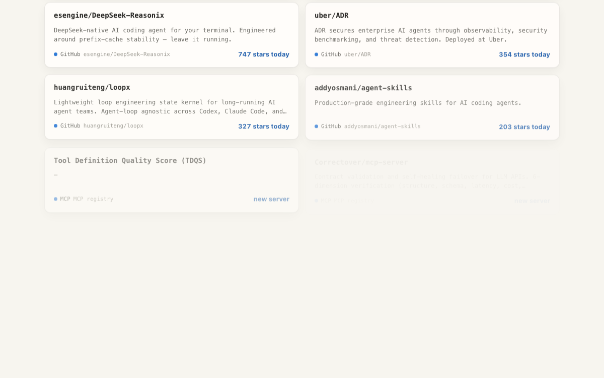

<!--
  Surya Thakur: founder of Dex and Yoki, builder of Signals Radar. Digital marketer, SEO, landing pages, AI agents.
  GitHub: https://github.com/SuryaThakur999
-->

  

    
  
  <h1></h1>
  

  
  
  

---

## About me

I'm a digital marketer who got tired of doing the same growth chores by hand, so I started building software that does them. I write landing pages that convert, newsletters people open and websites that rank, and I put **AI agents and LLMs** to work on the parts nobody wants to do twice.

Right now that means two products for small businesses, **Dex** and **Yoki**, plus the open-source scrapers I use to watch what's landing. If it can be measured, I'd rather script it than screenshot it.

---

## Now building

<table>
<tr>
<td width="33%" valign="top">

### Dex
**The pages that need help most are the ones you never check.**

Your AI marketing team, supervised. Dex finds the pages that need help, drafts the fix in your voice, checks its own work and waits for your yes.

</td>
<td width="33%" valign="top">

### Yoki
**You crossed the €100,000 VAT line in March. Your Steuerberater tells you in June.**

Your accountant gives you the numbers. Yoki tells you what they mean next: cash, VAT and tax-threshold radar for German founders, freelancers and their Steuerberater.

</td>
<td width="33%" valign="top">

### Signals Radar
**Stop doom-scrolling five feeds to find what's worth making.**

A free, no-API-key scraper. It sweeps GitHub Trending, Reddit, YouTube, the MCP registry and X every other morning into one page you skim in two minutes.

</td>
</tr>
</table>

Dex and Yoki are commercial products. Their source code is private; the showcase repos show what they do. Signals Radar is open source.

---

## Also built

| Project | What it does |
|:---|:---|
| **[Sift](https://github.com/SuryaThakur999/sift)** | Point it at any world (competitors, a market, a beat, a niche) and it sweeps every other morning into one skimmable dashboard with a trends tab. $0, no API keys. |
| **[Projector-2030](https://github.com/SuryaThakur999/Projector-2030)** | An Apple TV-inspired home screen for Android TVs and projectors. Debloat over Wi-Fi, no root. |
| **[KAIROS](https://github.com/SuryaThakur999/pmo-bot)** | A RACI deadline tracker that drafts your Outlook reminders and ranks the week on one local dashboard. |

---

## Tech Stack

### AI & Agents

  
  
  
  
  

### Landing Pages & Web

  
  
  
  
  
  
  
  

### SEO & Analytics

  
  
  
  
  

### Marketing & Growth

  
  
  
  
  

### Newsletter & Email

  
  
  

---

## GitHub Analytics

  

<picture>
  <source media="(prefers-color-scheme: dark)" srcset="https://github-readme-activity-graph.vercel.app/graph?username=SuryaThakur999&theme=tokyo-night&hide_border=true&area=true" />
  <source media="(prefers-color-scheme: light)" srcset="https://github-readme-activity-graph.vercel.app/graph?username=SuryaThakur999&theme=minimal&hide_border=true&area=true" />
  
</picture>

---

## Recent Writing

<!-- BLOG-POST-LIST:START -->
<!-- BLOG-POST-LIST:END -->

I write about digital marketing, landing pages, SEO, and putting AI agents to work on growth. Recent work:

- 📬 [My project: Automotive Newsletter](https://suryathakur999.github.io/roland-berger/newsletters/automotive-newsletter.html)
- 🖥️ [My project: IAA MOBILITY 2027 Landing Page](https://suryathakur999.github.io/roland-berger/landing-pages/iaa-mobility-2027.html)
- 🗂️ [All my project samples](https://suryathakur999.github.io/roland-berger/)

---

## Connect

  
  
  
  
  

---

## Support My Work

If a tool here saved you an hour, feed the dream the 911 isn't gonna buy itself. 🥹

  

---

  

